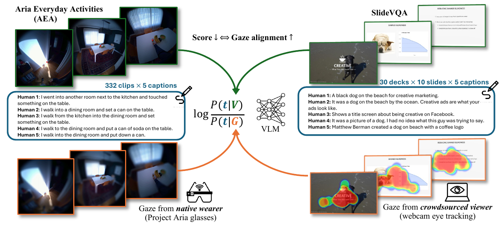

<div align="center">

# VEGAS: Human-Aligned Video Caption Evaluation via Gaze

**Transactions on Machine Learning Research (TMLR), 2026**

<a href="https://vivianchen98.github.io/VEGAS_website/"></a>
<a href="https://arxiv.org/abs/2607.08489"></a>
<a href="https://huggingface.co/datasets/vivianchen98/VEGAS"></a>

<br><br>



</div>

## TL;DR

VEGAS is a training-free metric for evaluating video captions with human gaze. It compares model behavior on raw and gaze-conditioned visual inputs to score whether caption tokens are grounded in visual evidence that people actually attended to.

## Setup

```bash
conda create -n vegas python=3.10 -y
conda activate vegas
pip install -e .
cp .env.example .env
```

Add API keys to `.env` if you use hosted model backends:

```bash
OPENAI_API_KEY=...
GOOGLE_API_KEY=...
```

<details>
<summary>Agent checklist</summary>

- Run all commands from the repository root.
- Use Python 3.10 and install `ffmpeg` before preparing AEA video clips.
- `src/data/download_dataset.py` updates `.env` with `ARIAEVERYDAY_ROOT` and `SLIDEVQA_ROOT`.
- Replace `/path/to/original/...` with local paths to the original Aria Everyday Activities and SlideVQA datasets.
- Configure API keys or a local model backend before running full VEGAS scoring.

Optional smoke test without model calls:

```bash
python src/experiments/compute_vegas.py --config-name=ariaeveryday dry_run=true limit=5
python src/experiments/compute_vegas.py --config-name=slidevqa dry_run=true limit=5
```

</details>

## Data

Download the released VEGAS metadata, captions, gaze, heatmaps, and segment files from Hugging Face:

```bash
python src/data/download_dataset.py --output-dir data/VEGAS
```

The Hugging Face release does not redistribute all original raw media from the source datasets. To run end-to-end scoring, first obtain local copies of the original datasets:

- Aria Everyday Activities: <https://huggingface.co/papers/2402.13349>
- SlideVQA: <https://huggingface.co/papers/2301.04883>

Then prepare local media files from your copies of those datasets:

```bash
python src/data/prepare_media_subset.py \
  --dataset all \
  --aea-source-root /path/to/original/AriaEverydayActivity \
  --slidevqa-source-root /path/to/original/SlideVQA/slides
```

<details>
<summary>Expected local data layout</summary>

```text
data/
├── VEGAS/                      # Downloaded from Hugging Face
│   ├── AriaEverydayActivities/
│   │   ├── aggregated_captions.csv
│   │   ├── gaze_features/
│   │   ├── metrics/
│   │   └── ...
│   └── SlideVQA/
│       ├── aggregated_captions.csv
│       ├── gaze_features/
│       ├── heatmaps/
│       ├── metrics/
│       └── ...
└── VEGAS_MEDIA/                # Prepared locally from original datasets
    ├── manifest.csv
    ├── AriaEverydayActivities/
    │   ├── raw/*.mp4
    │   └── foveated/*.mp4
    └── SlideVQA/
        ├── raw/*.jpg
        └── heatmap/*.png
```

`data/` is ignored by Git and should remain local.

</details>

## Run VEGAS

Compute VEGAS scores:

```bash
python src/experiments/compute_vegas.py --config-name=ariaeveryday
python src/experiments/compute_vegas.py --config-name=slidevqa
```

Set `VEGAS_LOG_LEVEL=DEBUG` in `.env` to show detailed scoring diagnostics; the default is `INFO`. Gemini video processing waits up to 300 seconds by default; override with `upload_timeout_seconds=600` on the scoring command. Failed processing stops waiting immediately.

## Evaluation

Compute caption comparison metrics:

```bash
python src/experiments/evaluate_captions.py --config-name=ariaeveryday
```

## Citation

If you use this code or dataset, please cite:

```bibtex
@article{chen2026vegas,
  title={VEGAS: Human-Aligned Video Caption Evaluation via Gaze},
  author={Chen, Shenghui and Li, Po-han and Sun, Ximeng and Yang, Shijia and Barsoum, Emad and Liu, Zicheng and Chinchali, Sandeep and Topcu, Ufuk},
  journal={Transactions on Machine Learning Research},
  year={2026},
  url={https://arxiv.org/abs/2607.08489}
}
```
